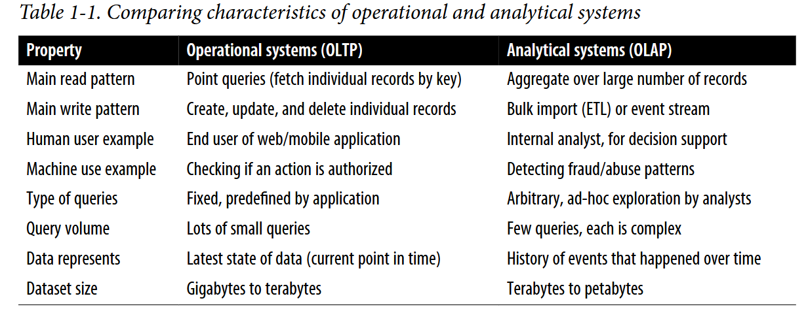
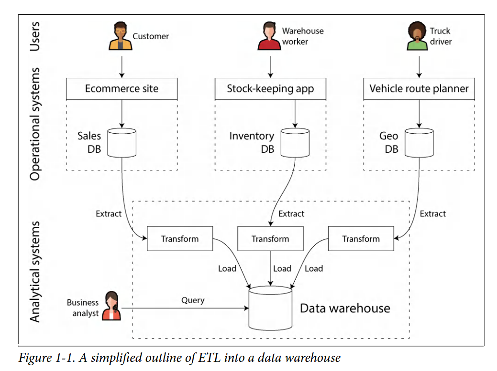

# `CHAPTER 1 - TRADE-OFFS IN DATA SYSTEMS ARCHITECTURE`
<i>There are no solutions; there are only trade-offs. […] But you try to get the best trade-off you
can get, and that’s all you can hope for.  
—Thomas Sowell, interview with Fred Barnes (2005)</i>

## `Introduction`
Small amounts of data, which can be stored and processed on a single machine, are
often fairly easy to deal with. However, as the data volume or the rate of queries
grows, it needs to be distributed across multiple machines, which introduces many
challenges.

## `Operational vs Analytical Systems`
### Quick definition
* **Operational System** : Consist of the backend and the infrastructure where data is created
* **Analytical System** : Read-Only sets or copy of data (From the Operational System) that especially serve the need of business domain specialist and data analysts

Operational and Analytical systems are kept separate for good reasons. As these systems have matured, two new specialized roles
have emerged: `Data Engineers` and `Analytics Engineers`.

### Note: 
The meaning of online in OLAP is unclear; it probably indicates
that queries are not just for predefined reports,   but that analysts
use the OLAP system interactively for explorative queries.

## `Data Warehousing`
Def : Separate database system for analytics purposes.
The data warehouse contains a read-only copy of the data from all the various OLTP
systems in the company 
Data is extracted from OLTP databases (using either a periodic data dump or a continuous stream of updates),  
transformed into an analysis-friendly schema, cleaned up, and then loaded into the data warehouse.
This process of getting data into the data warehouse is known as `extract–transform–load (ETL)`.

So basically, we have diffenrent OLTP sources and then the Data warehouse is built by :  
extracting data, transforming(denormalizing it) the data extracted and finally loading it in the Data warehouse.
Sometimes the loading process and tranformation process are swapped so the `Transformation`
process is done inside the Data warehouse.

### `Fom Data Warehouse to Data Lake`
What is a Data Lake ?
It's a `response to the ideal format` of the data extracted from Operational Systems via ETL for the use of Data analysis.
A Data Warehouse often uses a `relational data model` that is queries through SQL, or using specialized BI software.
This model works well for types of queries Business Analysts need to make, but it's less well suited to the needs of data 
scientists performing tasks such as these:
* Transforming data into a form that is suitable for training an `ML model` such as `vector`, `matrix`...
* Using `natural language processing (NLP)` techniques on textual data (e.g reviews of a product)  to try to extract structured information from it (e.g. the sentiment of the author, or which topics they mention).

Although there have been efforts to add ML operators to a SQL data model and build efficient ML systems on top of relational foundation, many data scientists prefer not to work in a relational database such as a data warehouse.Instead, many prefer to use `Python data analysis libraries` such as `Pandas` and `scikit-learn`, `statistical analysis languages such as R`, and distributed analytics frameworks such as `Spark`.
The difference from a data warehouse is
that a data lake simply contains files, without imposing any particular file format, data model or schema. Files in a data lake might be collections of database records,
encoded using a file format such as `Avro` or `Parquet`. Besides being
more flexible, a data lake is also often `cheaper than relational data storage`.

